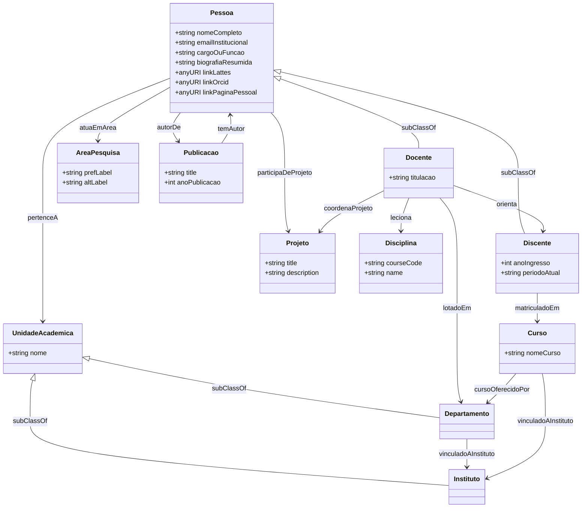
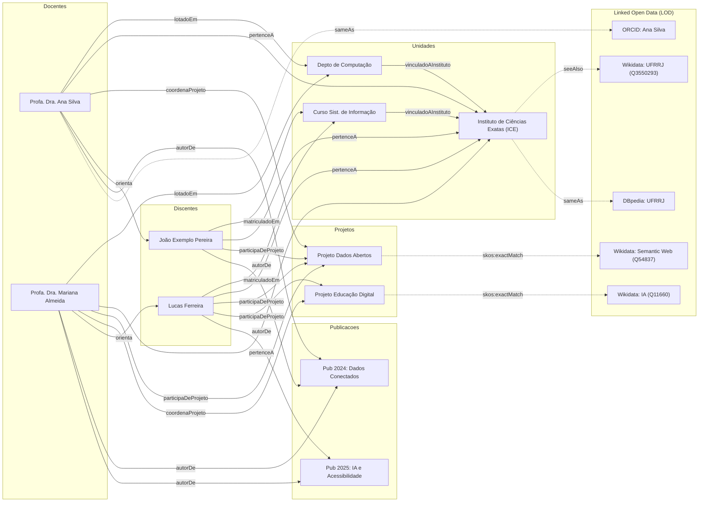

# Diagrama Conceitual da Ontologia de Perfis Acadêmicos

Este diagrama ilustra as classes, relacionamentos (Object Properties) e propriedades de dados que compõem o modelo ontológico da UFRRJ.

---

## 2. Diagrama de Instâncias e Relacionamentos do Grafo (RDF Data Graph)

